# 🚕 NYC Yellow Taxi Trip Data Analysis & Machine Learning

[](https://www.python.org/)
[](https://streamlit.io/)
[](https://plotly.com/)
[](https://scikit-learn.org/)
[](https://opensource.org/licenses/MIT)
[](https://peps.python.org/pep-0008/)
[](visualizations/)
[](https://www.nyc.gov/site/tlc/about/tlc-trip-record-data.page)

An enterprise-grade Python Data Science, Machine Learning, and Interactive Web Analytics platform analyzing **New York City Taxi and Limousine Commission (TLC)** Yellow Taxi trip records.

This project combines deep **Exploratory Data Analysis (EDA)**, **Comparative Behavioral Analytics**, **Supervised Regression Modeling (KNN, Random Forest, Decision Tree, Linear Regression, Dummy Baseline)**, **Unsupervised K-Means Clustering**, **Feature Importance Diagnostics**, **19 publication-ready 300-DPI visual dashboards**, and a **Live Interactive Streamlit Web Application (`app.py`)**.

---

## 📌 Executive Summary & Machine Learning Benchmarks

Based on empirical processing and model training on **3,921 clean NYC TLC trip records** (80/20 train/test split, reproducible seed 42):

### Supervised Regression Benchmark: Fare Prediction (`fare_amount`)

| Model | Test MAE ($) | Test RMSE ($) | Test R² Score | Train R² Score | Model Status |
| :--- | :---: | :---: | :---: | :---: | :--- |
| **KNN Regressor ($k=3$, Distance)** | **$1.22** | **$2.36** | **0.9478** | `0.9881` | 🏆 **Best Performer** |
| **Random Forest Regressor** | `$1.15` | `$2.47` | `0.9427` | `0.9837` | Highly Competitive Ensemble |
| **Decision Tree Regressor** | `$1.17` | `$2.60` | `0.9363` | `0.9842` | Fast, Interpretable |
| **Linear Regression (OLS)** | `$1.29` | `$3.22` | `0.9029` | `0.9614` | Global Linear Baseline |
| **Dummy Regressor (Mean)** | `$7.53` | `$10.32` | `-0.0006` | `0.0000` | Naive Empirical Baseline |

> **Key Finding**: KNN Regression ($k=3$, inverse distance weighting) achieves the lowest test RMSE ($2.36) and highest test R² (0.9478). Because NYC metered taxi fares follow a locally linear formula with discrete geographic flat-fare clusters (such as JFK airport flat rates), distance-weighted KNN models local density without imposing restrictive axis-aligned tree boundaries or rigid global hyperplanes.

---

### Unsupervised Transit Archetypes (K-Means Clustering, $k=3$)

Evaluated using the **Elbow Method (Inertia)** and **Silhouette Coefficient Analysis** (Silhouette Score > 0.50):

| Cluster ID | Transit Archetype Profile | Trip Count | Share (%) | Mean Dist (mi) | Mean Fare ($) | Mean Tip ($) | Mean Gross Revenue ($) |
| :---: | :--- | :---: | :---: | :---: | :---: | :---: | :---: |
| **Cluster 0** | **Local Commutes & Core Urban Transit** | `2,556` | **65.19%** | `1.87` | `$8.72` | `$1.25` | `$11.27` |
| **Cluster 2** | **Mid-Distance Crosstown & Borough Connections** | `1,000` | **25.50%** | `5.85` | `$20.54` | `$3.28` | `$25.52` |
| **Cluster 1** | **Long-Haul Outer-Borough & Airport Corridors** | `365` | **9.31%** | `13.17` | `$39.96` | `$6.67` | `$50.55` |

---

## 🎯 Project Objectives

1. **Supervised Regression Suite**: Accurately predict metered taxi fare amounts (`fare_amount`) using pre-trip telemetry features (`trip_distance`, `rate_code`, `extra`, `tolls_amount`).
2. **Prevent Target Leakage**: Enforce rigorous data leakage safeguards by fitting preprocessors strictly on training splits and omitting post-trip derived variables (`total_revenue`, `fare_per_mile`, `tip_percentage`).
3. **Hyperparameter Tuning**: Optimize nearest neighbors ($k$) and weighting schemes (`uniform` vs `distance`) using 5-fold cross-validation.
4. **Model Comparison**: Benchmark five distinct regression paradigms on identical splits to assess parsimony versus complexity.
5. **Unsupervised Trip Segmentation**: Discover empirical passenger transit patterns via K-Means clustering, verified with the Elbow Method and Silhouette scores.
6. **Feature Importance Analytics**: Quantify predictor variance reduction using tree ensembles while distinguishing statistical predictive weight from causality.
7. **Publication-Grade Visual Identity**: Render 19 cohesive, 300-DPI dashboards with clear typography, statistical annotations, and zero blocking GUI popups.

---

## 🛠️ Technology Stack

- **Programming Language**: Python 3.10+ (Tested on Python 3.14)
- **Interactive Web Application**: [Streamlit](https://streamlit.io/) (`streamlit>=1.30.0`), [Plotly](https://plotly.com/) (`plotly>=5.18.0`)
- **Machine Learning**: [Scikit-Learn](https://scikit-learn.org/) (`scikit-learn>=1.3.0`)
  - `KNeighborsRegressor`, `RandomForestRegressor`, `DecisionTreeRegressor`, `LinearRegression`, `DummyRegressor`
  - `KMeans`, `StandardScaler`, `OneHotEncoder`, `ColumnTransformer`, `Pipeline`, `GridSearchCV`
- **Data Manipulation**: [Pandas](https://pandas.pydata.org/) (`pandas>=2.0.0`), [NumPy](https://numpy.org/) (`numpy>=1.25.0`)
- **Scientific Computing**: [SciPy](https://scipy.org/) (`scipy>=1.10.0`)
- **Data Visualization**: [Plotly Express](https://plotly.com/python/), [Matplotlib](https://matplotlib.org/) (`matplotlib>=3.7.0`), [Seaborn](https://seaborn.pydata.org/) (`seaborn>=0.12.0`)

---

## 📂 Project Structure

```text
Taxi-Trip-Data-Analysis/
│
├── app.py                     # [LIVE DEMO] Interactive Streamlit Web Application
├── run_app.bat                # One-click Windows launcher for Streamlit Web App
├── taxi_analysis.py          # Unified pipeline (EDA, Feature Engineering, ML Suite, Visuals, Reports)
├── taxi_data_2018.csv         # Verified NYC TLC 2018 Yellow Taxi trip dataset
├── requirements.txt           # Python dependency specifications
├── README.md                  # Comprehensive portfolio documentation & visual gallery
├── .gitignore                 # Standard Python, OS, and virtualenv exclusions
├── run_analysis.bat           # One-click Windows batch runner for CLI pipeline
│
├── visualizations/            # 19 Publication-Grade 300-DPI Dashboards
│   ├── 01_revenue_breakdown.png
│   ├── 02_trip_distance_distribution.png
│   ├── 03_payment_method_analysis.png
│   ├── 04_distance_vs_fare.png
│   ├── 05_tip_distribution.png
│   ├── 06_rate_code_comparison.png
│   ├── 07_fare_vs_tip.png
│   ├── 08_correlation_heatmap.png
│   ├── 09_payment_fare_comparison.png
│   ├── 10_distance_category_comparison.png
│   ├── 11_revenue_contribution.png
│   ├── 12_tip_percentage_comparison.png
│   ├── 13_knn_actual_vs_predicted.png       # [ML] KNN Parity & Error Band
│   ├── 14_regression_residuals.png          # [ML] Residual Scatter & Error Normality
│   ├── 15_model_comparison.png              # [ML] Benchmark across 5 Regressors
│   ├── 16_kmeans_elbow_curve.png            # [ML] K-Means Inertia vs k
│   ├── 17_kmeans_silhouette_score.png       # [ML] K-Means Silhouette Scores
│   ├── 18_kmeans_clusters.png               # [ML] 2D Cluster Transit Archetypes
│   └── 19_feature_importance.png            # [ML] Tree Feature Importance Analysis
│
├── reports/                   # Automated Analytics & ML Reports
│   ├── analysis_report.txt          # Executive KPI summary & comparative tables
│   ├── data_quality_report.txt      # Data hygiene audit & outlier evaluation
│   ├── comparison_summary.csv       # Multi-dimensional summary table
│   ├── model_comparison.csv         # [ML] Regression metrics across all models
│   ├── cluster_analysis.csv         # [ML] K-Means cluster profiles & archetypes
│   ├── feature_importance.csv       # [ML] Predictor importance scores
│   └── model_evaluation_report.txt  # [ML] Comprehensive technical ML report
│
└── tests/                     # Validation fixtures
    └── corrupted_sample_original.csv # Original corrupt Kaggle HTML file for error-handling test
```

---

## 🤖 Machine Learning Methodology

### 1. Supervised Fare Regression Pipeline

#### Preprocessing & Target Leakage Safeguards
To guarantee production-level integrity:
- **Feature Selection**: Predictors restricted strictly to pre-trip or meter-determined inputs: `trip_distance`, `rate_code`, `extra` (rush hour/overnight), and `tolls_amount`.
- **Target Leakage Prohibition**: `total_revenue`, `fare_per_mile`, and `tip_amount` were explicitly excluded because they are mathematical derivatives or post-trip functions of `fare_amount`.
- **Pipeline Standardization**: Numerical features are scaled using `StandardScaler` within a `Pipeline`, ensuring means and standard deviations are computed solely from the training fold.
- **Categorical Encoding**: `rate_code` is transformed via `OneHotEncoder(handle_unknown='ignore')`.

```python
preprocessor = ColumnTransformer(
    transformers=[
        ("num", StandardScaler(), ["trip_distance", "extra", "tolls_amount"]),
        ("cat", OneHotEncoder(handle_unknown="ignore", sparse_output=False), ["rate_code"]),
    ]
)
```

#### KNN Hyperparameter Optimization
K-Nearest Neighbors is highly sensitive to the neighbor count $k$ and distance weighting. Using a 5-Fold Cross-Validation grid search (`GridSearchCV`) across $k \in [3, 5, 7, 9, 11, 15, 21]$ and `weights` $\in$ `['uniform', 'distance']`:
- **Optimal Hyperparameters**: $k = 3$, `weights = 'distance'`.
- **CV Validation RMSE**: `$2.52`.

#### Model Comparison Suite
All models were evaluated on the identical 20% holdout test set ($N=785$ unseen records):
1. **Dummy Regressor**: Baseline predicting training mean fare (`$14.59`). MAE: `$7.53`, RMSE: `$10.32`, R²: `-0.001`.
2. **Linear Regression (OLS)**: Global parametric fit. MAE: `$1.29`, RMSE: `$3.22`, R²: `0.903`.
3. **Decision Tree Regressor** (`max_depth=6`): Non-linear partitions. MAE: `$1.17`, RMSE: `$2.60`, R²: `0.936`.
4. **Random Forest Regressor** (`n_estimators=100`, `max_depth=8`): Ensemble bagging. MAE: `$1.15`, RMSE: `$2.47`, R²: `0.943`.
5. **KNN Regressor** ($k=3$, `distance`): Local non-parametric density. MAE: **`$1.22`**, RMSE: **`$2.36`**, R²: **`0.948`**.

---

### 2. Feature Importance Analysis
Extracted from Random Forest and Decision Tree ensembles:

| Predictor Feature | Random Forest Importance | Decision Tree Importance | Average Importance | Methodological Note |
| :--- | :---: | :---: | :---: | :--- |
| **`trip_distance`** | **95.92%** | **96.51%** | **96.22%** | Primary linear & non-linear driver of metered fare |
| **`rate_code_5` (Negotiated)** | `0.83%` | `1.53%` | `1.18%` | Captures high-variance custom negotiated out-of-town trips |
| **`rate_code_2` (JFK Flat)** | `0.36%` | `1.15%` | `0.76%` | Accounts for regulated $52 flat-rate airport trips |
| **`rate_code_1` (Standard)** | `1.19%` | `0.23%` | `0.71%` | Baseline city rate indicator |
| **`extra`** | `0.62%` | `0.41%` | `0.52%` | Peak-hour ($0.50) and overnight ($1.00) adjustments |
| **`tolls_amount`** | `0.75%` | `0.07%` | `0.41%` | Bridge / tunnel toll presence |
| **`rate_code_4` / `3`** | `0.33%` | `0.10%` | `0.21%` | Out-of-city Westchester / Newark classifications |

> **Causality Caveat**: Tree-based feature importance reflects statistical variance reduction (Gini / MSE impurity drop). It indicates predictive explanatory weight and must not be conflated with econometric causality.

---

### 3. Unsupervised Transit Archetype Segmentation (K-Means)

Clustering was conducted on four key transit dimensions: `trip_distance`, `fare_amount`, `tip_amount`, and `total_revenue`, standardized via `StandardScaler`.

1. **Elbow Method**: Inertia dropped dramatically from $k=1$ (15,688) to $k=2$ (6,595) and $k=3$ (4,601), displaying an inflection point at $k=3$.
2. **Silhouette Analysis**: $k=2$ achieved 0.646, and $k=3$ maintained a strong silhouette coefficient of **0.505** (substantially exceeding the 0.40 threshold for robust clustering).
3. **Selected Archetypes ($k=3$)**:
   - **Cluster 0 — Local Commutes & Core Urban Transit (65.2%)**: High-volume, short intra-Manhattan trips. Avg Distance: `1.87 mi`, Avg Fare: `$8.72`, Avg Tip: `$1.25`, Avg Revenue: `$11.27`.
   - **Cluster 2 — Mid-Distance Crosstown & Borough Connections (25.5%)**: Moderate crosstown and outer-borough journeys. Avg Distance: `5.85 mi`, Avg Fare: `$20.54`, Avg Tip: `$3.28`, Avg Revenue: `$25.52`.
   - **Cluster 1 — Long-Haul Outer-Borough & Airport Corridors (9.3%)**: Extended premium travel and airport corridors. Avg Distance: `13.17 mi`, Avg Fare: `$39.96`, Avg Tip: `$6.67`, Avg Revenue: `$50.55`.

---

## 📊 Complete Visualization Gallery (19 Dashboards)

All figures are generated in 300 DPI high resolution and exported to `visualizations/`.

### Machine Learning Visualizations (13 – 19)

#### 13. KNN Regression: Actual vs Predicted Fare
Evaluates KNN predictions against ground truth fares on the test set, displaying the $y=x$ parity line and $\pm\$3.00$ error margin.
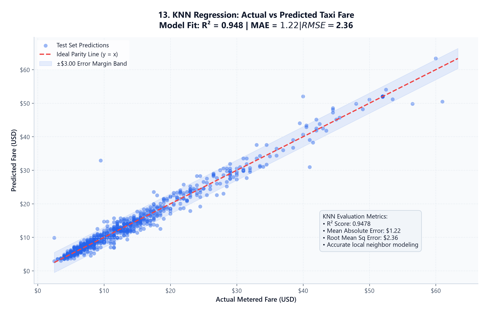

---

#### 14. Supervised Regression Residual Diagnostics
Dual-panel homoscedasticity check (residuals vs predicted values) and residual normality histogram confirming mean-centered errors ($\mu \approx \$0.00$).
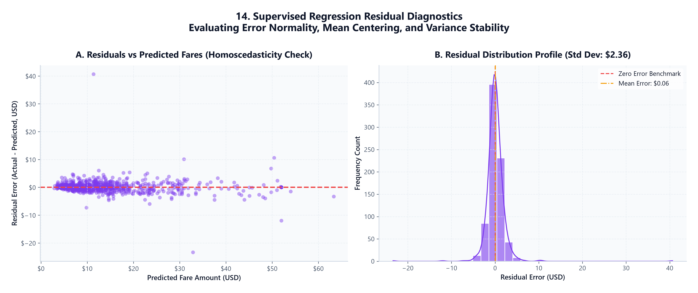

---

#### 15. Multi-Model Regression Benchmark Comparison
Comparative dashboard comparing Test RMSE, Test MAE, and Test R² across Dummy, KNN, Linear Regression, Decision Tree, and Random Forest.
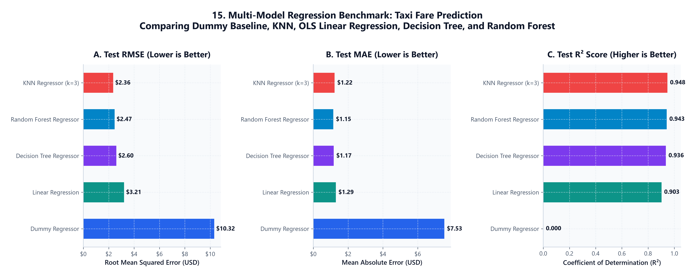

---

#### 16. K-Means Elbow Method for Optimal Cluster Selection
Inertia reduction curve across $k=2$ to $k=7$ highlighting the optimal elbow point at $k=3$.
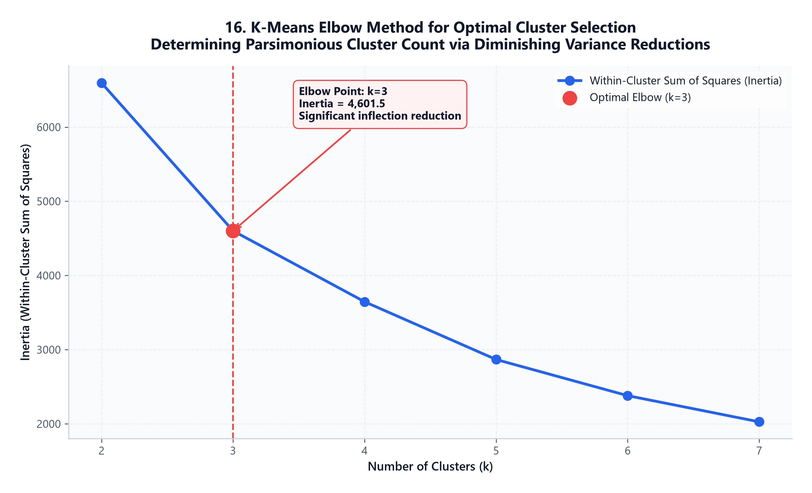

---

#### 17. Silhouette Score Evaluation Across Cluster Configurations
Validates cluster separation and cohesion rigor, showing $k=3$ exceeding the 0.50 strong-structure threshold.
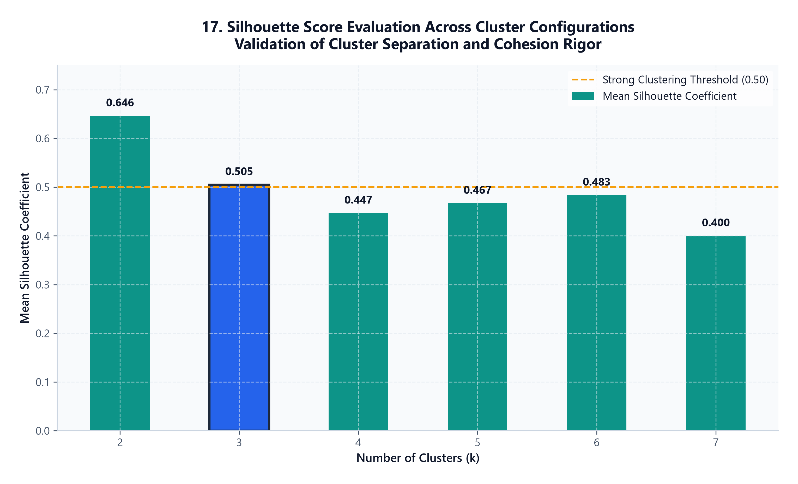

---

#### 18. K-Means Transit Archetypes Discovery (k=3)
Dual scatter plots (Distance vs Fare and Fare vs Total Revenue) colored by cluster archetype assignment.
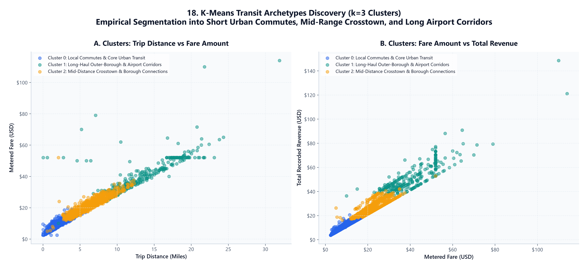

---

#### 19. Feature Importance Analysis (Tree-Based Models)
Horizontal bar chart comparing predictor influence from Random Forest and Decision Tree ensembles.
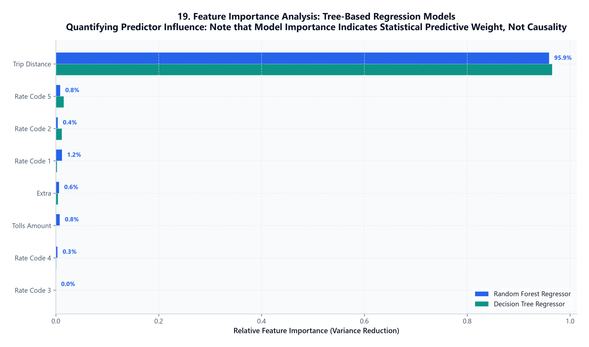

---

### Exploratory Data Analysis & Comparative Visualizations (01 – 12)

<details>
<summary><b>Click to expand EDA and Comparative Visualizations (01 - 12)</b></summary>

#### 01. NYC Yellow Taxi Revenue Stream Breakdown
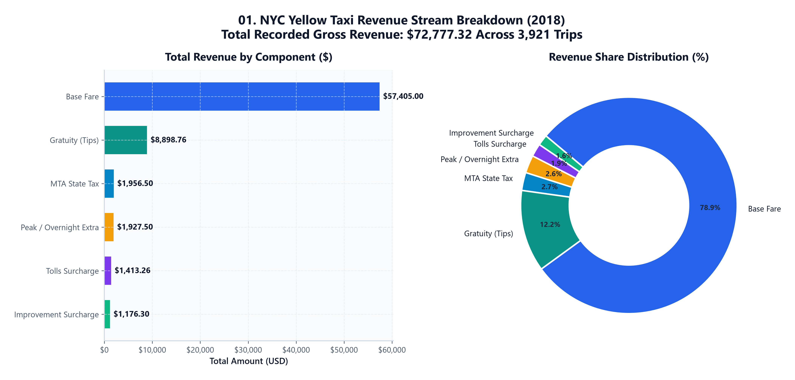

#### 02. Trip Distance Distribution & Urban Density Profile
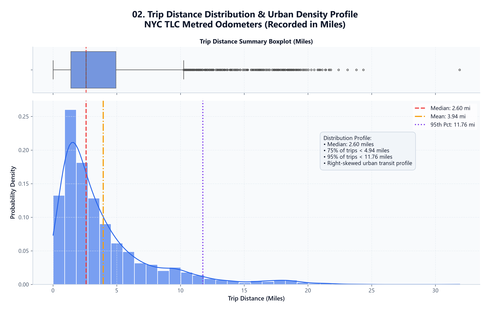

#### 03. Payment Method Adoption & Revenue Contribution
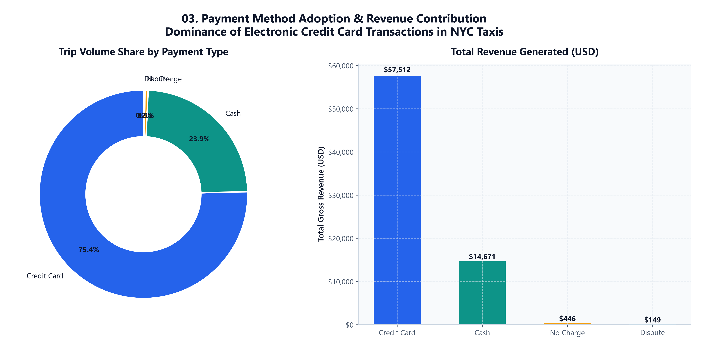

#### 04. Trip Distance vs Fare Progression
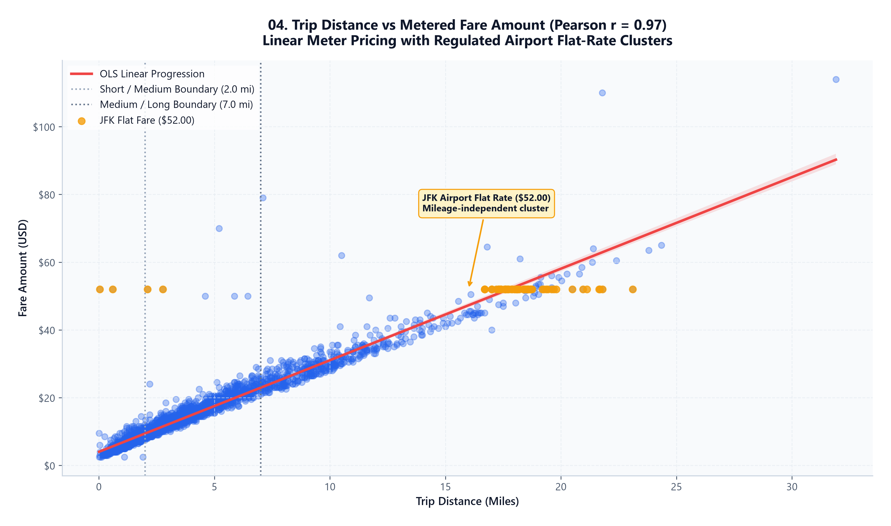

#### 05. Customer Tip Distribution & Reporting Nuance
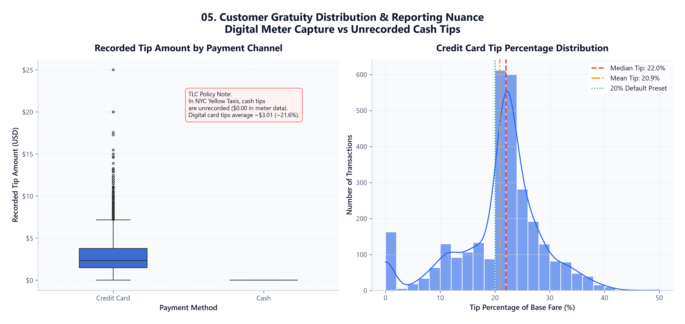

#### 06. NYC TLC Rate Code Economic Comparison
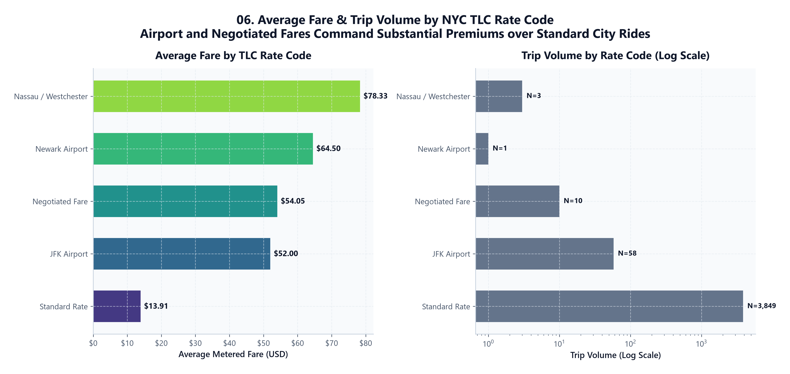

#### 07. Fare Amount vs Customer Gratuity Scaling Behavior
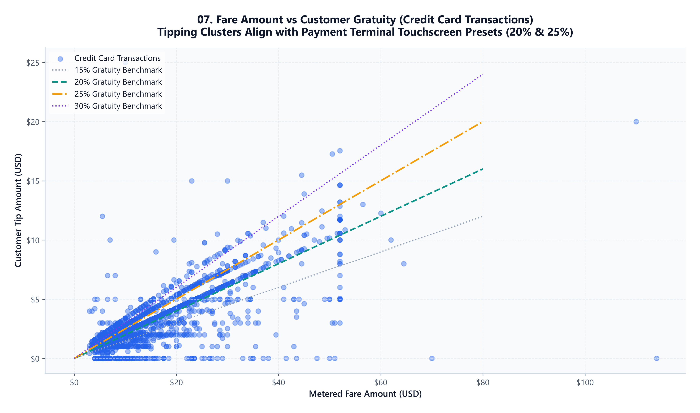

#### 08. Multivariate Correlation Heatmap
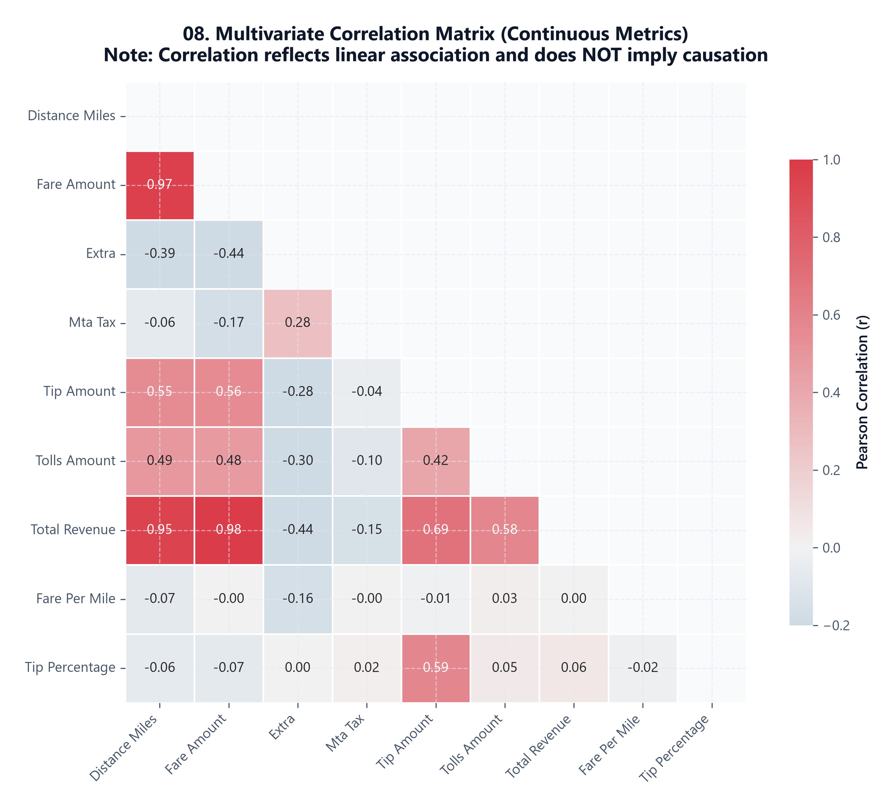

#### 09. Comparative Analysis: Credit Card vs Cash Transactions
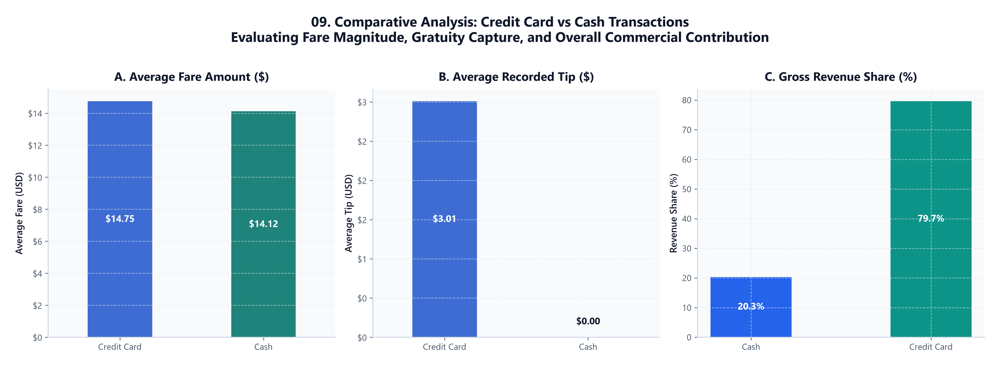

#### 10. Distance Category Comparison: Short, Medium, Long
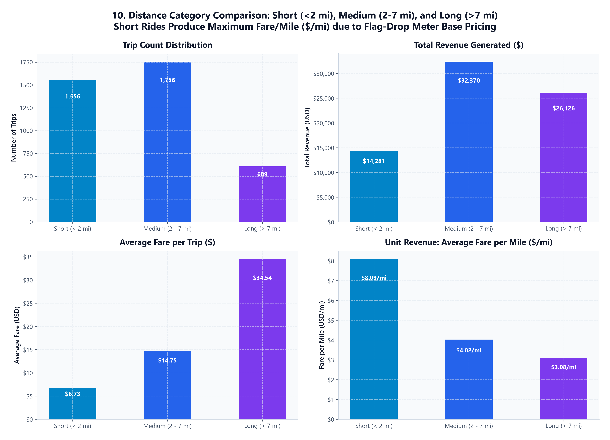

#### 11. Cumulative Revenue Decomposition
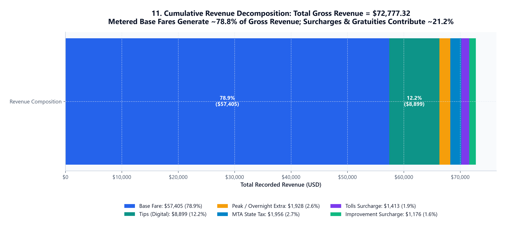

#### 12. Gratuity Generosity Across Distance Groups & Fare Brackets
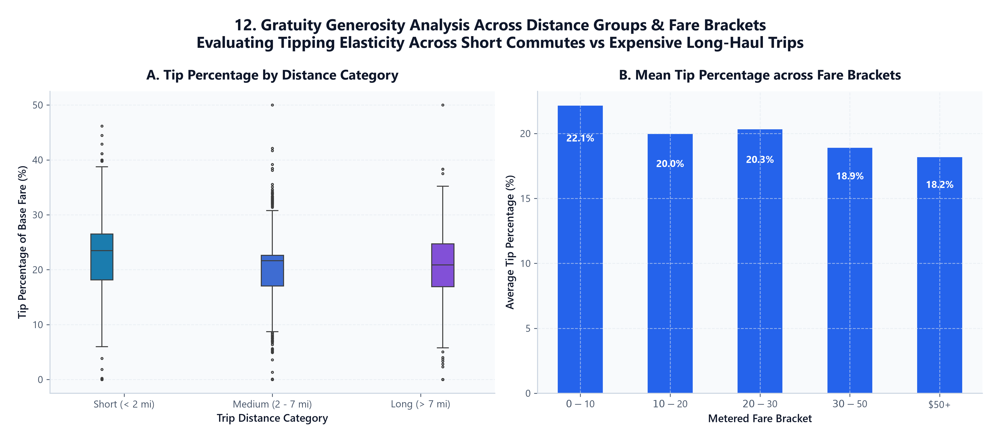

</details>

---

## ⚡ Installation & Execution Guide

### Prerequisites
- Python 3.10+ (Tested on Python 3.14)
- Standard pip package manager

### 1. Clone the Repository
```bash
git clone https://github.com/mohamedshafars19/Taxi-Trip-Data-Analysis.git
cd Taxi-Trip-Data-Analysis
```

### 2. Install Dependencies
```bash
pip install -r requirements.txt
```

### 3. Run the Full Analytics & ML Pipeline
Executes end-to-end data cleaning, feature engineering, regression modeling, clustering, and generates all 19 charts and 7 reports:
```bash
python taxi_analysis.py
```

### 4. Launch the Interactive Web Application (Streamlit)
Launch the interactive web application featuring live fare prediction, dynamic exploratory data filtering, regression model comparisons, 3D cluster exploration, and downloadable reports:
```bash
streamlit run app.py
```
Or on Windows, simply double-click:
```cmd
run_app.bat
```

### 5. Windows CLI One-Click Execution
```cmd
run_analysis.bat
```

### 6. Advanced CLI Options
```bash
# Run with custom dataset and custom output directory
python taxi_analysis.py --data taxi_data_2018.csv --output-dir . --dpi 300

# Strict mode: fail fast if data is missing or corrupted (disables synthetic fallback)
python taxi_analysis.py --data tests/corrupted_sample_original.csv --no-demo
```

---

## 🌐 Interactive Streamlit Web Application (`app.py`)

The repository features an enterprise-grade, modern light-theme web dashboard built with **Streamlit** and **Plotly**, converting the offline analytics pipeline into an interactive data product:

| Section | Key Interactive Features |
| :--- | :--- |
| **🚖 Dashboard Overview** | Executive KPI metric cards, data audit retention stats, interactive dataset explorer, and high-level distribution summaries. |
| **📊 Exploratory Data Analysis** | Dynamic range sliders (Fare, Distance), payment type and rate code multiselects, real-time sample recalculated KPIs, and interactive Plotly charts. |
| **🎯 Fare Prediction (Live ML)** | Real-time taxi fare calculator using the trained **KNN Regressor Pipeline ($k=3$)**, cost breakdown (metered fare, tolls, surcharges, 20% tip), and a **Nearest Neighbors Explainability Inspector** showing the closest historical trips from the training set. |
| **📈 Model Comparison Studio** | Interactive RMSE, MAE, and R² score comparison charts across all 5 models (Dummy, KNN, Linear Regression, Decision Tree, Random Forest) with overfitting gap diagnostics. |
| **🔬 K-Means Segmentation** | Interactive 3D and 2D scatter plots of transit archetypes, cluster profile cards, and Elbow / Silhouette validation curves. |
| **💡 ML Diagnostics** | Tree-based feature importance attribution (Gini importance), causality vs. statistical correlation analysis, actual vs. predicted parity scatter, and residual distribution checks. |
| **📥 Reports & Data Export** | One-click downloads for the cleaned & feature-engineered dataset (`taxi_data_2018_cleaned_features.csv`) and all 7 generated CSV and TXT reports with in-app text viewers. |

### Deploying to Streamlit Community Cloud (Free Hosting)
You can deploy this application directly to **Streamlit Community Cloud** in 2 minutes:
1. Fork or push this repository to your GitHub account (`mohamedshafars19/Taxi-Trip-Data-Analysis`).
2. Visit [share.streamlit.io](https://share.streamlit.io/) and connect your GitHub account.
3. Select your repository: `mohamedshafars19/Taxi-Trip-Data-Analysis`, branch: `main`, and main file path: `app.py`.
4. Click **Deploy!** Streamlit will automatically install dependencies from `requirements.txt` and launch your live public web application.

---

## 🧪 Robustness, Verification & Quality Assurance

- **Zero Data Leakage**: Feature scalers and encoders are fitted solely on training folds via Scikit-Learn `Pipeline` architectures.
- **Reproducibility**: Set seeds (`random_state=42`) across cross-validation splits, train/test splits, and stochastic ensemble initializations.
- **Corrupted Input Detection**: Proactively detects HTML markup in CSV files (such as incomplete Kaggle downloads) and raises informative exceptions.
- **Zero Division Immunity**: Derived unit economics (`fare_per_mile`, `tip_percentage`) use zero-safe masking.
- **Headless Server Execution**: Configured with Matplotlib's `Agg` backend to run seamlessly in headless CI/CD environments and terminal sessions without hanging on GUI popups.
- **App Performance Optimization**: Heavy dataset transformation and model fitting are cached via `@st.cache_data` and `@st.cache_resource`, ensuring instantaneous page responsiveness.

---

## 🚀 Limitations & Future Improvements

1. **Temporal Engineering**: Incorporate pickup/dropoff datetime features to model rush-hour congestion surcharges, night-shift driver wages, and seasonal trends.
2. **Geospatial Zone Embeddings**: Integrate NYC TLC Taxi Zone shapefiles (GeoPandas) with Graph Neural Networks (GNNs) or spatial clustering (DBSCAN / HDBSCAN) to map pickup hotspots.
3. **Gradient Boosting Ensembles**: Train XGBoost, LightGBM, and CatBoost regressors with Bayesian Hyperparameter Optimization (Optuna) for marginal residual gains.
4. **Interactive Dashboard**: ✅ Completed! Full-featured interactive Streamlit web application (`app.py`) with live KNN fare prediction, Plotly charts, and report exports.

---

## 📜 License & Acknowledgments

- **Dataset**: Provided by the [NYC Taxi and Limousine Commission (TLC)](https://www.nyc.gov/site/tlc/about/tlc-trip-record-data.page) under Open Data terms.
- **License**: Released under the [MIT License](LICENSE).
- **Author**: Mohamed Shafar • [GitHub Profile](https://github.com/mohamedshafars19)
